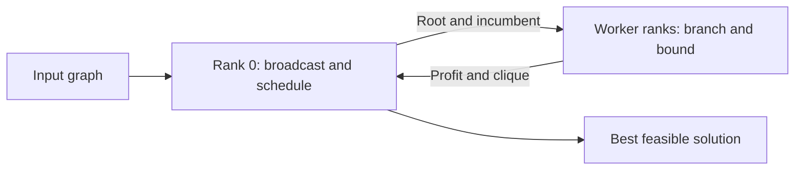

# Distributed Budgeted Maximum-Weight Clique Solver

An MPI exact branch-and-bound solver for finding the most profitable clique in an undirected graph under a cost budget. Built in C++17 with a sequential executable and an MPI implementation that distributes search subtrees across processes. Python tools generate reproducible instances, validate results, and measure scaling.

## Problem

Each vertex has a nonnegative profit and a positive cost. Select a set of vertices such that every pair is connected, total cost is at most the budget, and total profit is maximized. The empty clique is allowed and has profit zero. Different optimal vertex sets may exist; the solver returns one.

In [the four-vertex example](examples/tiny.txt), profits are `[8, 7, 9, 4]`, costs are `[4, 3, 6, 2]`, and budget is `7`. Vertices `0` and `1` are connected and give profit `15` at cost `7`. Although `{0, 1, 2}` is a clique, its cost is `13`; `{1, 3}` costs `5` but yields only `11`. The optimum is `{0, 1}`.

## Build and quick start

Requirements: a C++17 compiler, GNU Make, an MPI implementation providing `mpic++` and `mpirun`, and Python 3.9 or later. Only plotting requires an external Python package. The current build was verified with Apple Clang and Open MPI; MPI uses GCC bitset scanning methods when available, with a standard-library fallback for other compilers.

```sh
make
./build/clique-seq examples/tiny.txt build/tiny-seq.txt
mpirun -np 4 ./build/clique-mpi examples/tiny.txt build/tiny-mpi.txt
python3 scripts/check.py examples/tiny.txt build/tiny-seq.txt --optimal
python3 scripts/check.py examples/tiny.txt build/tiny-mpi.txt --optimal
```

Use `make sequential` if MPI is unavailable, and `make mpi` to build only the distributed executable. Override toolchains with `make CXX=g++ MPICXX=mpic++`. `make clean` removes build artifacts.

## Search and distribution

Both executables share the search engine in [src/solver.hpp](src/solver.hpp). It uses fixed arrays, bitset candidates, ratio ordering, greedy coloring, fractional-knapsack bounds, and root traversal. The sequential runner and MPI with one rank both call the same `solve_all()` function. MPI communication is provided through worker-only hooks; the sequential executable has no MPI dependency.

Vertices are sorted by descending profit-to-cost ratio using exact integer cross-products, with input vertex IDs retained for output. Adjacency is stored in fixed-width 1,201-bit bitsets with at most 1,200 valid vertices. Candidate intersections enforce the clique condition, while removing each explored vertex prevents duplicate branches.

Two upper bounds prune search:

- **Fractional knapsack:** ignore adjacency, fill the remaining budget in ratio order, and allow a fraction of the last vertex. Integer arithmetic floors this bound safely because feasible objective values are integral.
- **Greedy coloring:** partition candidates into independent color classes and sum the largest profit in each class. A clique can select at most one vertex from each class.

Every feasible search prefix updates the incumbent before pruning. A subtree begins with one vertex and permits only later vertices, so each nonempty clique belongs to exactly one root task.

With `P > 1`, MPI rank 0 reads and broadcasts the graph, dispatches root tasks dynamically, and retains the best result. The other `P - 1` ranks search subtrees. Each dispatch includes the current incumbent. Workers report improved profits during recursion and periodically poll for coordinator updates; completed tasks return their locally discovered profit and vertex set. Coordinator updates use nonblocking sends with stable buffers to avoid cyclic blocking. The graph broadcast uses raw struct/bitset data and assumes compatible binaries and object layouts across ranks. With one rank, MPI calls the same local search as the sequential executable.



## Data format and limits

Input is whitespace-separated:

```text
N E B
profit_0 cost_0
... N vertex rows ...
u v
... E undirected edge rows ...
```

Vertex IDs are zero-based. Both solvers retain 32-bit search arithmetic and validate these supported ranges: `0 <= N <= 1200`, `0 <= B <= 10^9`, profits in `[0, 10^9]`, and costs in `[1, 10^9]`. Edges must have distinct valid endpoints, with no duplicates. Invalid, incomplete, or trailing input is rejected. The sum of all vertex profits must additionally be at most `INT_MAX` (2,147,483,647), keeping search sums and bounds within 32-bit capacity. Ratio cross-products and the fractional multiplication use 64-bit intermediates.

Both executables require explicit input and output paths. Output has two lines: maximum profit, then sorted input vertex IDs; an empty optimum has an empty second line. Timing diagnostics go to stderr. Both use the same input checks and 32-bit arithmetic limits.

The problem is NP-hard. The vertex limit is a representation limit, not a promise of practical runtime on every instance. Recursion can reach depth `N`; graph density, profits, costs, budgets, and task imbalance strongly affect runtime. There is no search timeout inside the executables; the benchmark tool provides a subprocess timeout.

## Generate and validate

```sh
python3 scripts/generate.py --vertices 100 --density 0.5 \
  --max-profit 100 --max-cost 100 --budget 500 --seed 42 \
  --output build/random.txt
./build/clique-seq build/random.txt build/random-output.txt
python3 scripts/check.py build/random.txt build/random-output.txt
```

The default checker proves feasibility, budget compliance, and consistency of the reported profit. It does **not** prove optimality. Add `--optimal` for an independent exhaustive subset oracle, limited to 22 vertices. The exponential oracle is best used on considerably smaller graphs. Validation errors return a nonzero exit status.

```sh
make test
# Without MPI:
python3 tests/test_correctness.py --sequential-only
# If the launcher needs extra slots:
python3 tests/test_correctness.py --mpi-flags='--oversubscribe'
```

Both solvers are tested on random graphs against the oracle, infeasible roots, partial-clique incumbents, zero budgets/profits, empty and complete graphs, input vertex IDs, large integer values, the vertex limit, invalid input, invalid output, and optimality-check failures. MPI tests exercise one rank, multiple workers, and more workers than root tasks. Test subprocesses have timeouts to detect hangs.

## Benchmarks

```sh
python3 scripts/benchmark.py benchmarks/seq-vs-mpi/input.txt \
  --processes 1 2 4 8 --mpi-flags='--oversubscribe' --repeats 5 --warmups 1 \
  --graph-metadata benchmarks/seq-vs-mpi/generation.json \
  --output-dir benchmarks/local
python3 -m pip install -r requirements.txt
MPLCONFIGDIR=/tmp/clique-mpl python3 scripts/plot.py \
  benchmarks/local/summary.csv --output benchmarks/local/scaling.png
```

The benchmark uses Python subprocess wall time, including process launch, MPI initialization, input, broadcast, search, output, and finalization. It excludes compilation, graph generation, and validation. Separate search timings exclude input/output and MPI initialization, graph broadcast, and finalization; distributed search timings include task scheduling and incumbent communication. It runs warmups and repeated trials, validates every output, requires objective agreement, and uses the oracle when `N <= 22`. Agreement on larger graphs is not an independent proof of optimality.

Artifacts include raw trial timings, medians, output solutions, input hash, binary hashes, generation metadata when supplied, platform and CPU information, compiler/MPI versions, commands, Git revision and worktree status. Build flags are controlled by the Makefile; record overrides separately when changing them. Use multiple graph sizes, densities, seeds, and budgets for a broader study. Keep process counts within allocated resources, or explicitly pass `--mpi-flags='--oversubscribe'` for a local experiment.

`sequential_speedup = T_seq / T_MPI(P)` compares the executables. `mpi1_speedup = T_MPI(1) / T_MPI(P)` measures MPI scaling. `mpi1_efficiency = mpi1_speedup / P` counts all ranks, including the coordinator. Sequential and one-rank MPI use the identical search function. End-to-end MPI timings still include launch and initialization overhead; parallel scheduling and incumbent arrival order can affect search work. Use the MPI-one-rank baseline to assess MPI scaling; scheduling, incumbent communication, graph distribution, and the dedicated coordinator still affect it.

The measured [sequential-versus-MPI benchmark](benchmarks/seq-vs-mpi/README.md) compares sequential and MPI execution of the shared search engine. Raw trials, environment metadata, validated outputs, and a scaling chart are included. Results describe this workload and machine; use multiple graphs and machines before drawing general conclusions.

## Repository

| Path | Purpose |
| --- | --- |
| `src/` | Shared search engine, sequential runner, and MPI scheduler |
| `scripts/` | Generator, checker, oracle, benchmark, plotting |
| `examples/` | Worked example and expected solution |
| `tests/` | Correctness and failure-path integration tests |
| `benchmarks/seq-vs-mpi/` | Measured sequential-versus-MPI comparison |
