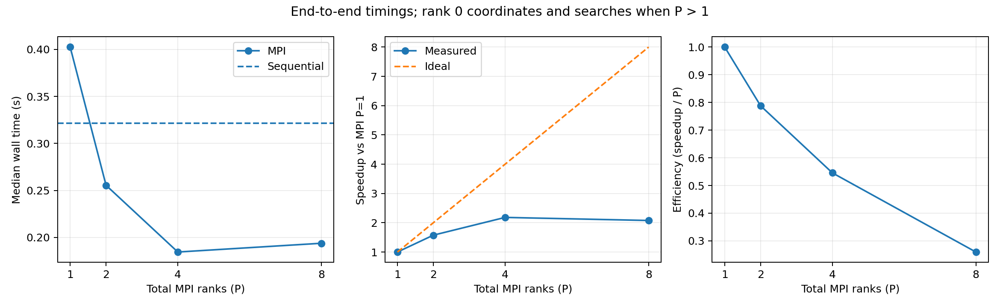

# Sequential versus MPI benchmark

Both executables use the search engine in `src/solver.hpp`. Sequential and one-rank MPI call the same root traversal and bounds. With multiple ranks, rank 0 coordinates and also searches, servicing incoming messages at recursive polling points. Incumbent updates use one stable in-flight buffer per worker; newer bounds are coalesced.

Measured on Apple M1 with 8 logical CPUs, Apple Clang, C++17 `-O3`, and Open MPI 5.0.9. Graph: 400 vertices, 39,890 edges, density parameter 0.5, budget 500, seed 42, profits/costs in 1–100. One warmup and five measured trials per configuration; rank counts 1, 2, 4, and 8. MPI commands use `--oversubscribe`.

| Implementation | Total ranks | Median search (s) | Median wall (s) | Search speedup vs seq | Wall speedup vs seq |
| --- | ---: | ---: | ---: | ---: | ---: |
| sequential | 1 | 0.315937 | 0.321563 | 1.00× | 1.00× |
| mpi | 1 | 0.319158 | 0.402463 | 0.99× | 0.80× |
| mpi | 2 | 0.171510 | 0.255419 | 1.84× | 1.26× |
| mpi | 4 | 0.093668 | 0.184426 | 3.37× | 1.74× |
| mpi | 8 | 0.070900 | 0.193748 | 4.46× | 1.66× |



Search timing excludes input/output, launch, MPI initialization/finalization, and graph broadcast. Distributed timing includes task preparation, coordinator search, scheduling, incumbent communication, and completion of pending updates. Wall time includes launch through exit.

All 25 measured outputs passed feasibility validation and agreed on profit 876. The graph is not independently checked for optimality. Integration tests compare both runners against exhaustive small-instance enumeration and cover empty input, surplus workers, infeasible roots, large integers, malformed input, and a complete 64-vertex graph.

All ranks can contribute search work. Rank 0 divides its time between searching and communication, so scheduling and polling overhead still affect scaling. These are one-machine, one-seed measurements. Eight-rank results are sensitive to small runtime and scheduling variation; improved performance is not guaranteed for every graph.

Reproduce:

```sh
make
python3 scripts/benchmark.py benchmarks/seq-vs-mpi/input.txt \
  --processes 1 2 4 8 --mpi-flags='--oversubscribe' --repeats 5 --warmups 1 \
  --graph-metadata benchmarks/seq-vs-mpi/generation.json \
  --output-dir benchmarks/local
MPLCONFIGDIR=/tmp/clique-mpl python3 scripts/plot.py \
  benchmarks/local/summary.csv --output benchmarks/local/scaling.png
```

Raw timings are in [trials.csv](trials.csv), summary metrics in [summary.csv](summary.csv), and commands, environment details, and source/binary hashes in [metadata.json](metadata.json).
